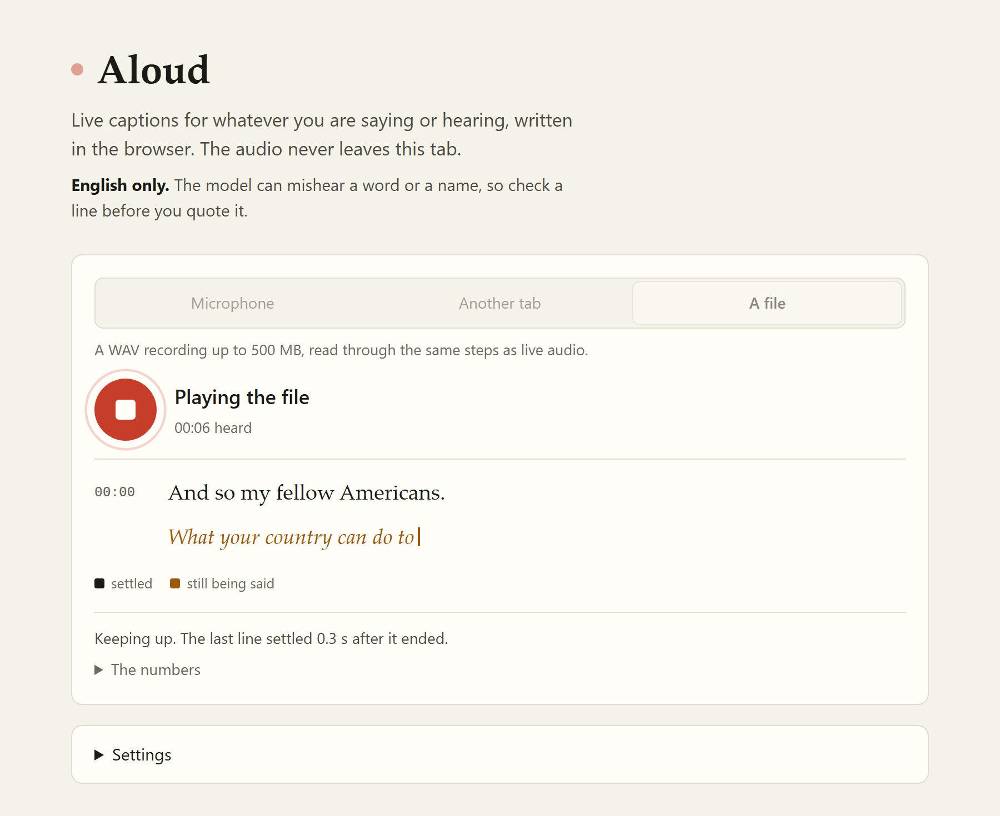

# Aloud

Live speech transcription that runs entirely in the browser. A 32 MB model is fetched once and
evaluated on your own machine, the audio never leaves the tab, and the transcript fills in
while you are still talking. English only.



## Why

Everything I could point at a work call wants the audio on someone else's server. That is a
reasonable trade for accuracy, and a bad one for a standup where somebody mentions a customer
by name. A small speech model on WebAssembly makes the other trade possible, and the point of
the benchmark below is to say exactly what that trade costs.

## Numbers

These come out of `pnpm bench`, which plays fixtures through the same pipeline as the app in a
real Chromium, scores the transcript against a reference where there is one, and writes a
report. Moonshine at q8, on WASM with twelve threads.

| Model                           | Download | WER  | Cost, file | Cost, live | Lag p50 | Lag p90 |
| ------------------------------- | -------- | ---- | ---------- | ---------- | ------- | ------- |
| moonshine-tiny                  | 32 MB    | 5.1% | 0.09       | 0.53       | 1.0 s   | 1.5 s   |
| moonshine-base                  | 67 MB    | 0.0% | 0.21       | 0.78       | 1.5 s   | 2.6 s   |
| whisper-base, the first version | 149 MB   | 0.0% | 0.48       | 1.21       | 4.4 s   | 8.1 s   |

Cost is the real-time factor: seconds of compute per second of audio, and under 1 means it
keeps up with someone talking. File is a recording read as fast as it goes. Live plays a
minute of English at real speed and reads the line still being spoken again every 0.6
seconds, which is where most of that cost goes. Lag runs from the end of a line to its text
being final. The voice detector adds 2 MB to every download.

The Whisper row is the old README's and was measured a little differently, one pass over each
whole file, so read it as the size of the change rather than a careful comparison.

WER is pooled over two scored clips and 39 reference words, which is enough to see the shape
and not enough to publish. Tiny's two errors are one short phrase, "ask not", which q8 tiny
hears as nothing at all. q4 weights score the same on these clips, run slower and download
59 MB, so the app ships q8.

Costs are noisy. The same work has run up to 1.9 times slower from one run to the next on this
laptop. Compare numbers within a run, not across runs.

One more caveat, because it has bitten this project twice. Word error rate is only as good as
its text normaliser. Before this one spelled out "Mr." and turned "fifty" into "50",
LibriSpeech scored 5.9%, and every one of those errors was the scoring rather than the model.
A WER quoted without saying which normaliser produced it is not a number.

It runs on WASM only. The WebGPU builds of onnxruntime are 27 and 28 MB, over the 25 MB
Cloudflare takes per file, and they need `eval` in the CSP. Tiny at q8 already reads a file
at under a tenth of real time on the CPU, so the GPU would buy nothing anyone could feel, and CI
has no GPU either.

### Running the benchmark

```
pnpm bench
```

Audio is fetched at run time from Hugging Face. `BENCH_MODELS`, `BENCH_DTYPE` and
`BENCH_STREAM` choose what runs, and `packages/bench/env.ts` has the rest. The report lands in
`packages/bench/report/`, and CI uploads it as an artifact.

Adding a fixture is an edit to `packages/bench/fixtures.json`. One with no reference is timed
but not scored, which is how the two clips without transcripts earn their place.

## Latency, in structure

A line is final once the speaker pauses. About three quarters of a second of silence closes it,
a quarter that the voice detector holds on after the last word and half a second the segmenter
waits after that, then the model reads the whole line once more, and that text stays. Until
then the line still being spoken is read again every step and shown as a guess. So confirmed
text trails the end of a sentence by the pause plus one pass, however long the sentence was.
Someone who never pauses gets cut at fifteen seconds, at the quietest moment near it.

A Moonshine pass costs what the line is long, because its encoder reads the audio it is given.
Whisper padded every window to thirty seconds and paid a second for a two-second line. That is
what makes reading the line under way again every 0.6 seconds affordable.

A decoder that loses the thread repeats itself until its token budget runs out, so a phrase
that comes three times or more at the end of a line is cut back to one copy. Only at the end,
because that is where a runaway decoder lives. A genuine repetition there gets cut as well,
and there are tests saying so in both directions.

The first version confirmed words by local agreement instead. The write-up of that design,
and everything that went wrong building it, is in [docs/local-agreement.md](docs/local-agreement.md).

## Privacy

The audio never goes anywhere. There is no server to send it to: the whole pipeline runs in
workers inside your tab.

The model weights are the one thing fetched over the network: from huggingface.co, on the
first run, pinned to a commit and cached afterwards. onnxruntime's WebAssembly ships inside
the build rather than coming from a CDN, so no code runs in the tab that did not come from
this repository's lockfile. After that it opens with the network off. Nothing is sent the
other way: no analytics, no error reporting, no account, no request that carries a word of
what you said. The Content-Security-Policy holds the page to that: it may connect to itself,
to Hugging Face's file hosts, and to huggingface.co only under the two organisations the
models come from, since the rest of that site is an API that would take an upload. A policy
cannot stop a page navigating away, so this is a fence rather than a proof.

Recordings and transcripts are kept in IndexedDB on the machine you used, the last ten
sessions, and "Delete all" means it. Clearing the site data clears them too, along with the
cached weights.

The weights stay in Cache Storage after the first download, 34 MB for the fast model and the
voice detector, and the summary model adds 23. Settings says how much is there and removes it.
It can also stop the app keeping the models between visits, at the price of downloading them
every time. That is a setting rather than a cleanup when the tab closes, because a closing tab
gets no reliable chance to finish deleting anything.

Capturing another tab shows the browser's own sharing indicator the whole time, which is the
browser telling you the truth about what is being read.

## Security

Most of it is the CSP in `packages/app/public/_headers`, and the comment above it says why each
part is there. Scripts and workers come from the site itself and nowhere else, with no
`unsafe-eval` and no `blob:`, while WebAssembly may still compile. The page refuses to be
framed, and only this origin may ask for the microphone or a screen.

The lockfile is installed frozen, GitHub Actions are pinned to commit hashes and the weights to
model commits. CI fails on a high or critical advisory in the production dependencies, and
Dependabot groups minor and patch updates into one pull request a week. `pnpm.overrides` lifts
a few transitive packages past their advisories; none of them reaches the browser. One moderate
advisory stays open: `sprintf-js`, which arrives through `onnxruntime-node`, the Node build that
transformers.js installs and a browser never loads. There is no fixed release yet.

## Status

It works end to end. A microphone, another tab's audio or a WAV file goes through one
pipeline: Silero voice detection, a segmenter that closes a line at each pause, Moonshine in a
worker. Confirmed lines are black and the line still being spoken is an amber guess.
Timestamps play that moment of the recording back, the transcript can be searched and exported
as Markdown, and the last ten sessions stay in IndexedDB with their audio. A service worker
makes the page open with the network off, and a Playwright test cuts the network to prove it.
The gist of a session is picked out of its lines with sentence embeddings.

What it does not have yet is more than two scored clips, or any automated test of the
microphone path, because a benchmark cannot speak.

## Running it

Node 24 (see `.nvmrc`) and pnpm 10.

```
pnpm install
pnpm dev
```

Pick a source and press start. The weights download once, then stay in the browser cache, so
the first run is slow and the rest are not.

`pnpm install` will mention two dependencies whose build scripts it skipped: `onnxruntime-node`
and `protobufjs`. They arrive with transformers.js, which also runs on a server, and neither is
reachable from a browser tab. Leave them unbuilt.

The one thing a host has to get right is the headers, and two of them carry the speed:

```
Cross-Origin-Opener-Policy: same-origin
Cross-Origin-Embedder-Policy: credentialless
```

They are what lets onnxruntime start its thread pool, which is worth roughly a factor of two
on WASM, and the `credentialless` variant is what still allows the weights to come from
Hugging Face. `packages/app/public/_headers` asks Cloudflare for them and ships in the
build output, together with the CSP. That policy allows `'wasm-unsafe-eval'` and not
`'unsafe-eval'`: WebAssembly may compile, JavaScript may not be built from strings. The
offline test serves the build with the same file. Anywhere else, set them yourself; without
the first two the app works and is half the speed.

```
pnpm build
pnpm dlx wrangler deploy
```

`wrangler.jsonc` makes it a Worker with no script, only the build as static assets. Cloudflare
builds and deploys every push to `main` on its own.

The build copies onnxruntime's plain WebAssembly build into `ort/`, 14 MB in one file. The
service worker keeps it for offline use, and transformers.js is told not to keep a second copy
of its own.

## Layout

```
packages/core   audio sources, resampling, WAV in and out, voice activity, cutting lines
                at pauses, the inference engine and both worker protocols
packages/app    Angular 22, zoneless, signals; owns the worklet asset, the two Workers and
                the IndexedDB archive
packages/bench  a page with no interface, driven by Playwright, that measures the same core
```

Audio sits behind an `AudioSource` adapter and the model behind a worker protocol. Neither
knows about the other, and neither knows whether a person or a fixture is on the far end.
That adapter is the reason the benchmark exists at all: the same pipeline runs with a
microphone on one end or a WAV file on the other, and only the file version can be scored.

## Things it will not do

It understands English and nothing else, because Moonshine was trained on English and nothing
else. The first version ran Whisper and did Russian too, at a median 19% word error on
spontaneous speech with whisper-base. That was not good enough to keep paying 149 MB for.

It is not instant on a phone: the first visit downloads about 34 MB before it can transcribe
anything, and the button says so before you tap it. After that the weights are cached and it
starts in a second.

It opens with the network off and shows the saved sessions, but it cannot transcribe offline,
even with every file cached. transformers.js 4.2 asks whether the model has a preprocessor by
looking it up under `main` rather than the pinned commit, the cache has it under the commit,
and with no network the answer comes back no. Unpinning would fix it and is not worth it.

It reads WAV and nothing else, up to 500 MB, because the file and its decoded copy sit in
memory together. Mono 16 kHz is all the model hears, so converting a long recording first
loses nothing, and an hour of it is 115 MB.

Speakers are not labelled. Working out who said what needs a separate embedding model plus
clustering, and it fails loudly enough that people trust the whole transcript less.

The gist is lines lifted out of the transcript by similarity and left as they were, because
an abstractive summary needs a second language model and a new way to be confidently wrong
about what somebody said.

A paid API is more accurate. Base makes no mistakes on the two scored clips here, but two
clips are two clips.

## What I would do differently

I wrote a latency budget before I could measure anything, and it was out by a factor of four.
The arithmetic was fine and the shape was wrong: I had the lag as one window step plus one
pass, when it is two of each, because local agreement needs the same audio to come round
twice. No amount of tuning the step fixes that, and I spent a day finding out by tuning the
step. The budget table stayed in the README next to the measurement for a while, which was the
most useful thing about it.

The measurement bugs outnumbered the code bugs. The word error rate was wrong twice, both
times because the normaliser scored "Mr." against "MISTER" and "50" against "пятьдесят" as
mistakes. The offline test failed twice, both times because of headers and timing in the test
rather than anything in the app. If I started again I would write the scorer and its tests
before the thing being scored, and I would treat a surprising measurement as a suspect
measurement first.

Two panels was wasted motion. The first version grew a "transcribe a file" panel and a
"stream a file" panel side by side, and the next one deleted both for one view with a source
picker. The pipeline underneath never changed. I should have built the source picker on day
one and let the file be a source like any other, which is what the `AudioSource` adapter was
for in the first place.

The SharedArrayBuffer ring never got built. The plan called for one, the capture worklet
still allocates a four kilobyte buffer on the audio thread fifty times a second, and nothing
has glitched. Leaving it is the right call on the evidence and it is still the piece I would
reach for first if a dropout ever showed up.

I should have started with Moonshine. Whisper pads every window to thirty seconds, so every
pass cost a second whatever was in it, so the lag was four seconds, so I built a stabiliser to
agree on words across passes. Moonshine reads a line in a fraction of that, and lines can
simply end at the pauses. The switch cost Russian and an essay's worth of machinery, and took
the download from 149 MB to 32.
